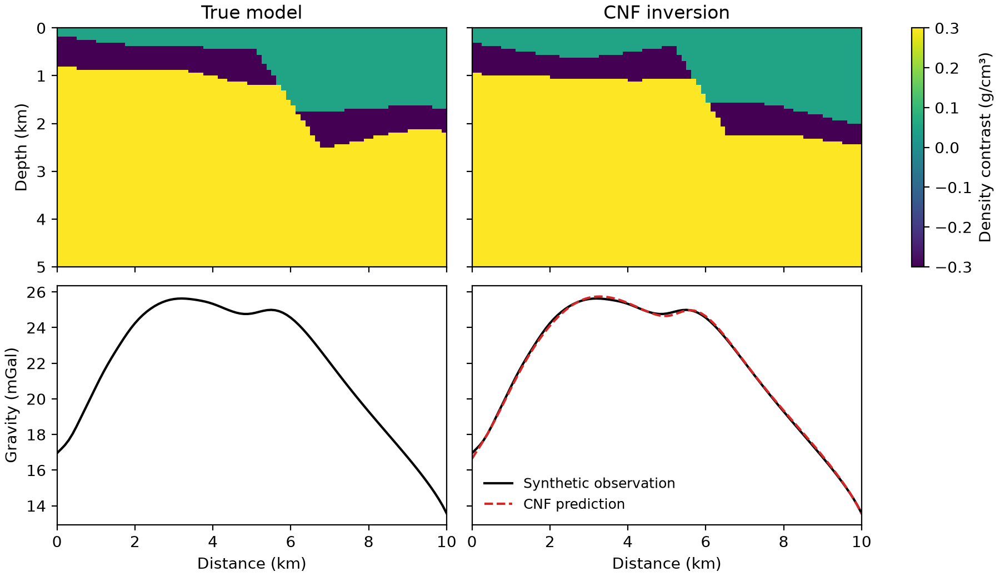

# Fourier-layer + fault conditional normalizing flow

Private research snapshot of the first single-fault synthetic benchmark. Not an open-source release; no redistribution license is granted here. Only the single-fault benchmark is included, not field data or cluster configuration.



## Experiment

Three layers, two Fourier interfaces and one explicit signed fault. Each interface has six active parameters: height, slope, and two cosine/sine pairs. The fault adds horizontal origin, signed dip and signed throw: **15 inferred parameters**. Density contrasts are fixed at **(0.05, -0.30, 0.30) g/cm³**, not inferred.

The physical domain is 10 km wide and 5 km deep, with an 80 × 80 density mesh. Normalized geometry uses x in [0,2] and depth in [0,1], with one normalized unit equal to 5 km. There are 101 surface-profile gravity stations at 50 m above the top of the model. The analytical rectangular-cell operator is 2-D (infinite strike), and responses are in mGal.

## CNF

The response encoder is 101 → 128 → 64 with SiLU activations. Eight autoregressive rational-quadratic spline transforms, interleaved with random permutations, model the conditional distribution of the 15 standardized parameters. Each transform uses 128 hidden features, two residual blocks, eight spline bins and linear tails outside ±5.

The supplied parameter dataset contains 10,000 models, split into 8,000 training, 1,000 validation and 1,000 test models. Parameter and response normalization are estimated on the training subset only. Training injects independent Gaussian response noise with standard deviation 0.1 mGal. The illustrative saved test observation is noise-free; do not describe this figure as a noisy-data test.

Training minimizes conditional negative log likelihood with AdamW (learning rate 3e-4, weight decay 1e-5), batch size 256, gradient clipping at 5, at most 150 epochs and validation early stopping after 20 epochs without improvement. The best validation checkpoint is retained.

Inference conditions the flow on the standardized observation, samples latent normal vectors and transforms them into geological parameters. Here 4,000 samples were evaluated with the hard geological forward model. The displayed reconstruction is the **minimum data-misfit sample**, not the maximum CNF-density/MAP sample. No SVGD or geological rejection is applied to these inference draws. Mean and variance are pixelwise statistics over all draws, including geometrically invalid draws; they are not guaranteed calibrated posterior uncertainty.

## Single-fault result

The left column shows the true density model and its synthetic gravity observation. The right column shows the CNF draw with the lowest relative gravity misfit among 4,000 draws and its predicted response at the same 101 stations. Its relative L2 gravity misfit is **0.3751%** and its density-image RMSE is **0.1163 g/cm³**.

## Reproduction

Use Python 3.11 or newer in a dedicated environment:

```bash
python -m venv .venv
source .venv/bin/activate
pip install -r requirements.txt
python verify_case.py
python plot_case.py
python sample_case.py --samples 4000 --seed 20260918
```

`verify_case.py` reconstructs the saved truth and selected CNF sample, checks gravity consistency, and recomputes the reported errors. `sample_case.py` runs fresh conditional inference from the supplied checkpoint; a fresh random sample need not reproduce the archived minimum exactly. Only load the supplied checkpoint if you trust its origin: PyTorch checkpoint loading can execute pickled code.

To retrain from the supplied valid parameters (recomputes all forward responses):

```bash
python train_multi_fault_cnf.py --n-faults 1 --source data/training --out runs/retrained --epochs 150 --train-only
```

The legacy `--models` option does not truncate the source dataset; the complete supplied dataset is used. The geological utility retains generic event handling, but only the single-fault data/checkpoint is supplied here.

## Files

- `data/case_20.npz`: archived example, sampled parameters, density images, predictions and diagnostics.
- `data/training/`: valid parameter dataset and original split indices.
- `checkpoints/conditional_nf.pt`: trained model and normalization, with local source path removed.
- `results/`: single-fault comparison figure and CNF metrics.
- `fourier_fault_prior.py`, `multi_fault_prior.py`: geological construction and validity checks.
- `train_multi_fault_cnf.py`, `train_nf_prior.py`: conditional training and spline-flow construction.
- `gravity_forward.py`: cell gravity kernel.
